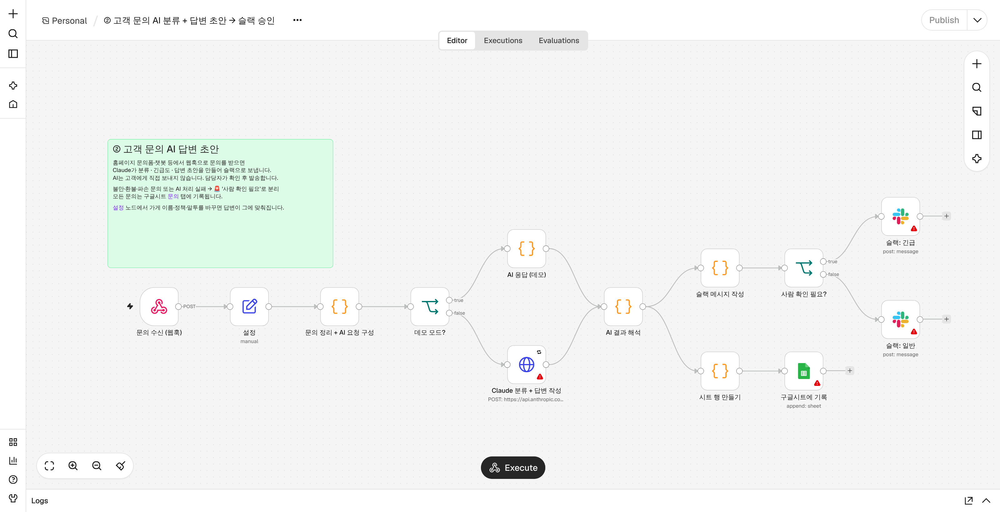
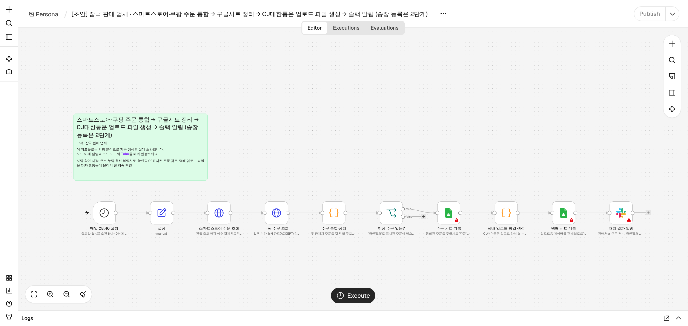

# 쇼핑몰 셀러용 n8n AI 자동화 포트폴리오

크몽 판매용 포트폴리오 겸, 고객에게 바로 납품할 수 있는 n8n 워크플로 3종과 영업 문서입니다.

| # | 워크플로 | 트리거 | 연동 |
|---|---|---|---|
| ① | [스마트스토어 신규주문 → 구글시트 → 슬랙](workflows/01_스마트스토어_주문_시트_슬랙.json) | 10분마다 | 네이버 커머스 API, Google Sheets, Slack |
| ② | [고객 문의 AI 분류 + 답변 초안](workflows/02_고객문의_AI_답변초안.json) | 웹훅 (POST) | Claude API, Slack, Google Sheets |
| ③ | [매일 아침 매출 리포트](workflows/03_일일_매출리포트.json) | 매일 08:30 KST | Google Sheets, Claude API, Slack, Gmail |

워크플로마다 맨 앞에 **`설정` 노드**가 있습니다. 고객이 바꿀 값(API 키, 시트 URL, 채널, 가게 정책)은 전부 여기 모여 있습니다.
`demoMode=true`(기본값)로 두면 외부 계정 없이 샘플 데이터로 전체 흐름이 돌아갑니다. 상담할 때 시연용으로 쓰시면 됩니다.



## 의뢰 처리 자동화 도구 (판매자용)

크몽 의뢰 내용을 붙여 넣으면 상담에 필요한 결과물이 한 번에 나옵니다.

```bash
pip install anthropic pydantic
```

```bash
ANTHROPIC_API_KEY=sk-ant-... python3 tools/intake.py 의뢰.txt --client "고객명" --seller "내 상호"
```

```bash
python3 tools/intake.py --demo
```

`projects/<날짜>_<고객>/` 폴더에 다음 파일이 만들어집니다.

| 파일 | 용도 |
|---|---|
| `01_요구사항_정리.md` | 내부용. PROBLEM·WHY·현재 수작업·연동 API 가능 여부·위험·판정 |
| `02_견적서.md` | 고객용. 패키지, 금액, 기간, 절감 효과(월 몇 시간, 몇 개월이면 회수), 포함/제외 범위 |
| `03_설계서.md` | 고객용. 흐름도(mermaid)와 단계별 설명 |
| `04_크몽_답장.txt` | 크몽 채팅에 그대로 붙여 넣는 첫 답장(이해한 내용, 진행 방식, 추가 질문) |
| `05_n8n_초안.json` | n8n에 바로 import 되는 워크플로 뼈대. 노드마다 설명이 붙어 있고 코드 노드에 `TODO` 표시 |

- **분석은 AI, 가격은 규칙:** 분석은 Claude가 하고, 가격은 [`tools/pricing.py`](tools/pricing.py)의 규칙으로 계산합니다(단계 수, 연동 서비스 수, AI 사용 여부, 난이도). 같은 의뢰면 항상 같은 가격이 나옵니다. 크몽 가격을 바꾸면 이 파일의 `PACKAGES`도 같이 바꾸세요.
- **거절 기준:** 티켓 매크로, SNS 대량 자동화 같은 거절 대상이면 견적서와 초안은 만들지 않고 정중한 거절 답장만 만듭니다.
- **프롬프트 인젝션 방지:** 의뢰문 안에 지시문이 있어도 분석 대상으로만 취급합니다.
- **AI 설정:** 모델은 `claude-opus-5-5`, `effort: high`, 결과는 JSON 스키마로 고정, 서버 측 fallback이 켜져 있습니다.



## 폴더 구조

```
workflows/   n8n에 바로 import 하는 완성 파일 (build.py가 생성)
src/code/    코드 노드 원본 JS. 수정은 여기서 하고 다시 빌드
src/build.py 워크플로 조립 스크립트
tools/       의뢰 처리 자동화 도구 (intake.py)
samples/     예시 의뢰문
projects/    도구가 만든 결과물 (예시 1건 포함)
src/vendor/  네이버 서명용 내장 bcrypt (bcryptjs 2.4.3, MIT)
test/        n8n 엔진 실행 테스트, Claude 실제 호출 점검
docs/        인터뷰 질문지, 크몽 상세페이지 초안, 스크린샷
```

## 고객 환경에 설치하는 순서

1. n8n에서 **Workflows → Import from file**로 JSON 파일을 가져옵니다.
2. 자격증명을 연결합니다. 경고 표시(⚠)가 뜬 노드를 열어 Credential을 선택하면 됩니다.
   - **Claude 노드**: `Header Auth` 자격증명을 새로 만들고 Name=`x-api-key`, Value=Anthropic API 키를 입력합니다.
   - **Google Sheets / Gmail / Slack**: n8n 기본 OAuth 연결을 사용합니다.
3. 구글시트를 만들고 탭과 1행 열 이름을 아래처럼 맞춥니다.
   - `주문` 탭(①이 기록하고 ③이 읽음):
     `결제일시 | 주문일시 | 주문번호 | 상품주문번호 | 상품명 | 옵션 | 수량 | 결제금액 | 주문자 | 수령인 | 연락처 | 주소 | 배송메모 | 수집일시`
   - `문의` 탭(②가 기록):
     `접수일시 | 채널 | 고객명 | 이메일 | 주문번호 | 분류 | 긴급도 | 감정 | 요약 | 사람확인 | 확인사유 | 문의내용 | 답변초안 | 처리상태`
4. `설정` 노드에서 `demoMode=false`로 바꾸고 나머지 값을 채웁니다.
5. 수동으로 1회 실행해 본 뒤 **Publish(활성화)** 합니다.

### ① 네이버 커머스 API
- [커머스API센터](https://apicenter.commerce.naver.com)에서 애플리케이션을 등록하고 `애플리케이션 ID`와 `시크릿`을 받습니다.
- 토큰 발급에 필요한 bcrypt 서명은 코드 노드 안에 내장되어 있습니다. 그래서 외부 모듈 설치가 안 되는 **n8n Cloud에서도 동작**합니다.
- 같은 주문은 한 번만 기록됩니다(처리한 상품주문번호를 워크플로가 기억). 조회 범위(`lookbackMinutes`, 기본 15분)를 실행 주기(10분)보다 길게 잡아서 누락을 막습니다.

### ② 고객 문의 웹훅
활성화하면 `https://<n8n주소>/webhook/cs-inquiry`가 생깁니다. 홈페이지 문의폼, 채널톡, Zapier 등에서 아래 형식으로 POST하면 됩니다.

```json
{ "name": "홍길동", "email": "a@b.com", "channel": "홈페이지", "orderNo": "2026...", "message": "배송 언제 오나요?" }
```

- AI는 **초안만** 만듭니다. 고객에게 자동으로 발송하지 않습니다.
- 환불·파손·강한 불만 문의, 또는 AI 처리 실패(거절·응답 잘림·형식 오류) 시 🚨 긴급 채널로 보냅니다.
- 고객이 쓴 문의 내용 안에 "이전 지시를 무시해" 같은 문장이 있어도 문의로만 취급하도록 프롬프트에서 막아 두었습니다.
- 가게 정책·말투는 `설정 → policies / tone`에서 바꿉니다.

### Claude API 설정
- 기본 모델은 `claude-opus-5-5`, `effort: low`입니다. 응답 형식은 JSON 스키마(structured outputs)로 고정되어 있습니다.
- 안전 필터가 요청을 거절하면 서버가 다른 모델로 자동 재시도하도록 `fallbacks: "default"`를 켜 두었습니다.
- 문의 1건당 비용은 대략 입력 2천 토큰, 출력 수백 토큰 수준입니다. Opus 5.5 기준으로 건당 몇십 원 정도로 예상됩니다(추정치, 실제 사용량 확인 필요).
- 문의량이 많은 고객이면 `설정 → model`을 `claude-haiku-5-5`로 바꿔 비용을 크게 줄일 수 있습니다. 바꾼 뒤에는 답변 품질을 샘플로 먼저 확인하세요.

## 테스트

n8n 2.x는 Node.js 24 이상이 필요합니다.

```bash
python3 src/build.py
```

```bash
N8N=/path/to/n8n python3 test/run_demo_test.py
```

```bash
ANTHROPIC_API_KEY=sk-ant-... python3 test/live_claude_check.py
```

- `run_demo_test.py`: 세 워크플로를 실제 n8n 엔진에서 데모 모드로 끝까지 실행합니다(외부 연동 노드는 비활성화한 사본으로 실행). ②는 불만 문의(긴급 분기)와 배송 문의(일반 분기) 두 케이스를 돌립니다.
- `test_intake.py`: 의뢰 처리 도구의 가격 판정, 거절 처리, 초안 생성을 테스트합니다(API 호출 없음).
- `live_claude_check.py`: ②가 만든 실제 Claude 요청을 API로 보내 응답이 스키마대로 오는지 확인합니다.

## 납품 전 체크리스트
- [ ] 고객 계정으로 네이버 토큰 발급, 주문 조회 1회 성공
- [ ] 시트 열 이름 일치 확인
- [ ] 슬랙 채널에 봇 초대
- [ ] ② 실제 문의 5~10건으로 답변 품질 확인 후 정책 문구 보정
- [ ] 워크플로 설정에서 Error Workflow를 지정해 오류 알림 받기(선택)

## 문서
- [요구사항 인터뷰 질문지](docs/01_요구사항_인터뷰_질문지.md)
- [크몽 상세페이지 초안](docs/02_크몽_상세페이지_초안.md)
- 스크린샷: [①](docs/screenshots/01_주문_시트_슬랙.png) · [②](docs/screenshots/02_고객문의_AI.png) · [③](docs/screenshots/03_매출리포트.png) · [③ 메일](docs/screenshots/03_매출리포트_메일.png)
